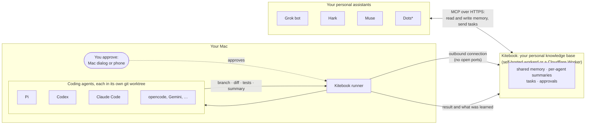
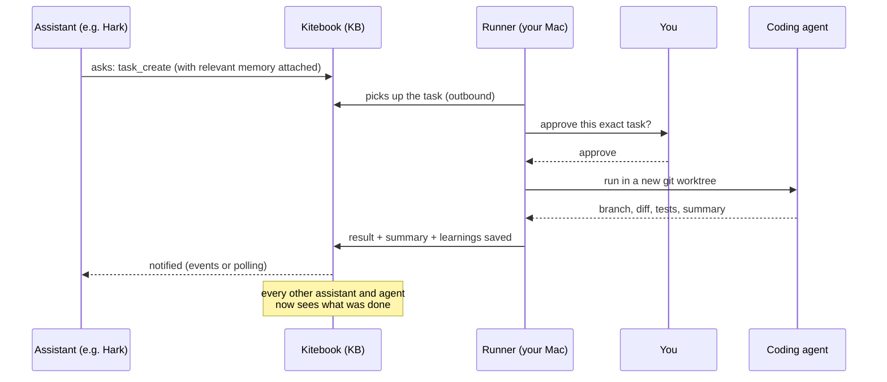

> [!WARNING]
> **Kitebook v0.0.1 is an early preview with a bunch of known bugs.** Expect things to break, and don't point it at anything you can't afford to lose. Please report bugs in [Issues](https://github.com/um1b/kitebook/issues). Known problems are listed in the [CHANGELOG](CHANGELOG.md#known-issues).

# Kitebook

**Your personal knowledge base across every agent, and the way your personal assistants (Grok bot, Hark, Muse, Dots\*) hand tasks to the coding agents on your Mac.**

   

Kitebook does two things for one person who uses many agents:

1. **A personal knowledge base that summarizes all your agents.** Shared memory, notes and files, plus a summary of what each agent did and learned, in one place you own. Every assistant and coding agent reads and writes it, so none of them starts from zero.
2. **Your personal assistants dispatch tasks to the coding agents on your Mac.** Grok bot, Hark or Muse asks; Pi, Codex or Claude Code does the work in a git worktree on your machine; you get back a branch, a diff, test results and a summary.

- **You approve each task** on your Mac or phone, and only that exact task.
- **Assistants never get a shell.** Your computer connects out, so no ports open.
- **Open and self-hosted.** One small server (your Mac or a Cloudflare Worker), MIT licensed.

<sub>\* Dots: untested / unverified. "Assistants" below always means these personal assistants; the agents on your Mac are "coding agents".</sub>

## Quick start
1. **Install.** On your Mac (or Linux), open Terminal and paste:
   ```bash
   curl -fsSL https://raw.githubusercontent.com/um1b/kitebook/main/scripts/get.sh | bash
   ```
   Windows (PowerShell): `irm https://raw.githubusercontent.com/um1b/kitebook/main/scripts/get.ps1 | iex`. It starts Kitebook, finds the coding agents you already have and opens Kitebook in your browser, signed in.
2. **Connect an assistant.** In Kitebook, open **Settings → Connection**, press **Turn on public access**, and give the `https://…/mcp` link it shows to your assistant (Hark, Muse, Grok bot) as an MCP connector, and keep the recommended **Read everything, save to shared memory, send tasks**.
3. **Send a task.** *"Use Kitebook to add a How to run it section to my project's README."* Approve it when asked; a branch and a summary come back, and every connected agent can see them.

Every step in detail: [docs/quickstart.md](docs/quickstart.md).

## How it works


<sub>\* Dots: untested / unverified.</sub>

Every assistant and every coding agent reads and writes the same knowledge base, so what one of them learns or does, the others can see. Your Mac's runner dials out to Kitebook, picks up tasks, asks you first, and hands each one to a coding agent in a separate git worktree.



One task's life: an assistant asks, Kitebook attaches what it already knows, your runner asks you, and only then does an agent run. The result, a short summary and anything the agent learned are written back into the knowledge base, so the next assistant or agent starts from there. More detail, including trust boundaries and what never leaves your Mac: [docs/architecture.md](docs/architecture.md).

## Who it's for, and why
For one person who uses many agents: a few personal assistants (Grok bot, Hark, Muse, Dots) to think and plan, and a few coding agents on their own machine to do the work, next to their repos and credentials.

Today each agent keeps its own memory, and every assistant needs its own bridge to every coding agent: N assistants times M agents, most of them a raw shell. Kitebook is **one open knowledge base and protocol** in the middle: every agent shares the same memory, sees what the others did, and can hand off work, with your approval in between.

## Supported assistants and agents
| Personal assistants (read memory, send tasks) | Status |
|---|---|
| Grok bot | Supported |
| Hark | Supported, used daily by the maintainer |
| Muse | Supported (MCP or an app key) |
| Dots | Untested / unverified |

Any other MCP client can connect too, with `https://<your-kitebook>/mcp`.

| Coding agents (do the work) | Status |
|---|---|
| Pi, Codex, Claude Code | Used daily by the maintainer |
| Gemini CLI, Cursor, GitHub Copilot CLI, opencode, Grok CLI | Supported, less tested |
| Aider, Cline, others | Not supported yet; tracked in the maintainer backlog |

Runs on macOS (main target), Linux and Windows 10/11. Per OS: [docs/setup.md](docs/setup.md#linux-and-windows).

## Safety, in short
- **Inside an approved task, the agent runs in its own auto mode** in a separate worktree. Your approval is the gate, so read what you approve.
- **The guard is not a sandbox.** It blocks common mistakes (`sudo`, force pushes, deploys, payments) but a determined agent can get past it. A real OS sandbox is on the roadmap.
- **An approval covers one exact task** and expires after 5 minutes. Signed tasks prove which app sent them.
- **The server never runs code**, never holds your agents' secrets and never gives an assistant a shell.

Full model: [docs/security.md](docs/security.md). Report problems privately: [SECURITY.md](SECURITY.md).

## Self-host
Kitebook is one server you own. Pick one:
- **Your Mac** (default): the one-line install runs the server and the runner together. Public access uses a built-in tunnel.
- **Cloudflare Workers**: [four commands](docs/setup.md#deploy-to-cloudflare), then connect your Mac from `/start`.
- **workerd / Docker on any box**: `scripts/serve.sh` or the Docker image ([docs/storage.md](docs/storage.md), [docs/releases.md](docs/releases.md)).
- **Local try-out** (cloud assistants can't reach it): `./scripts/quickstart.sh`.

## Develop and test
```bash
git clone https://github.com/um1b/kitebook && cd kitebook
npm install && echo ADMIN_TOKEN=dev-admin-token > .dev.vars
bun run typecheck      # zero errors
npm run test:fast      # unit tests + core end-to-end checks, about 2 min
./smoke.sh             # the full end-to-end suite, about 15 min
```
Code map and conventions: [CONTRIBUTING.md](CONTRIBUTING.md). Pull requests target `dev`.

## Contributing
**Please discuss changes before starting implementation or opening a PR.** Open issues are maintainer backlog items, not an invitation to implement them. Get agreement on the problem and scope in the issue first, and check for an existing PR. Bug reports with reproduction steps are welcome.

Read the [contribution guide](CONTRIBUTING.md) for scope, testing, AI-assisted contributions and review expectations. Accepted code PRs target `dev`. Questions go in [Discussions](https://github.com/um1b/kitebook/discussions). Please follow the [Code of Conduct](CODE_OF_CONDUCT.md).

## Learn more
| Doc | What's in it |
|---|---|
| [docs/architecture.md](docs/architecture.md) | Components, trust boundaries, what never leaves your Mac |
| [docs/quickstart.md](docs/quickstart.md) | The quick start step by step |
| [docs/features.md](docs/features.md) | Everything Kitebook does: tasks, chains, quick asks, shared memory, presence |
| [docs/setup.md](docs/setup.md) | Deploying, accounts, invites, OAuth and connectors |
| [docs/runner.md](docs/runner.md) | The runner: install, approvals, signed tasks, agents and models |
| [docs/git.md](docs/git.md) | Branches, commits, diffs and pull requests |
| [docs/agents.md](docs/agents.md) | For agents: endpoints, MCP tools, the op list |
| [docs/security.md](docs/security.md) | The security model |
| [docs/releases.md](docs/releases.md) | Binaries, updates, Homebrew, Docker |
| [docs/storage.md](docs/storage.md) | Where data lives, self-hosting, cost |
| [docs/glossary.md](docs/glossary.md) | Words used on screen |

> **Kitebook was called Relay** until October 2026. Old installs update to the new name by themselves; `relay` still works as a command, and `RELAY_*` environment variables are still read as `KITEBOOK_*`.

## License
[MIT](LICENSE). Provided "as is", without warranty: you run it on your own machine and you are responsible for reviewing what agents change. See [NOTICE](NOTICE) for third-party code.
