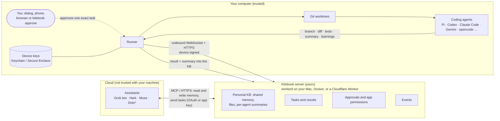

# How Kitebook works

Kitebook is a durable realtime workspace for one person who uses many agents: **a personal knowledge base** that every agent reads and writes, with a summary of what each one did, and **a dispatch path** that lets your personal assistants (Grok bot, Hark, Muse, Dots\*) hand tasks to the coding agents on your Mac.

Files, datasets and handoffs under `shared/`, `kb/` and `context/` survive client sandbox loss. Snapshot/checkpoint synchronization uses the durable commit journal independently of notification retention; see [Restart-safe shared workspaces](workspace-sync.md). Search is a derived view over versioned documents.

It has three parts: **personal assistants** (assistants for short) in the cloud that read memory and ask for work, a **server** you own that holds the knowledge base, tasks and approvals, and a **runner** on your computer that asks you and then hands each task to a coding agent. Words in bold below are in the [glossary](glossary.md).

\* Dots: untested / unverified. Any other MCP client can connect the same way.

The dashed line is the only gate that lets code run: you approving one task, on a device you own.

## Components
| Part | Where it runs | What it does |
|---|---|---|
| **Assistant** | The vendor's cloud | Calls MCP tools such as `task_create`, `task_get`, `kb_add`, `put`. It only sees the folders and actions you granted that app. |
| **Server (the knowledge base)** | Your Mac (workerd), any box (Docker), or Cloudflare (Workers + Durable Objects + R2) | Holds the personal knowledge base (notes, files, project context packs with what agents learned), every task with its result and summary, and approvals, in one SQLite object per workspace. Attaches relevant memory to new tasks. Checks each app's permissions. Sends events. Never runs code. |
| **Runner** | Your Mac (also Linux, Windows) | Keeps an outbound connection to the server. For each task: shows it to you, makes a git worktree, starts the chosen coding agent with a guard on its `PATH`, runs your verify commands, and reports the branch, diff and test results. |
| **Coding agent** | Your Mac, inside the worktree | The CLI you already use (Pi, Codex, Claude Code, …), with your own login. |
| **Device** | Each of your computers | Holds a device key and a presence key. Anything that widens access needs a fresh confirmation signed by one. |

## The shared memory
Assistants and agents write notes with `kb_add` and files with `put`, and search with `kb_search`. Each finished task leaves a summary, and agents' learnings land in the project's context pack, so the knowledge base doubles as a log of what each agent did. `presence` shows who is working on what right now, and with your OK an assistant can search your coding agents' own session history on your computer (read-only, secrets blanked, never stored on the server).

## One task, step by step
1. An assistant calls `task_create` with instructions, a project and an agent. Kitebook attaches the most relevant knowledge base entries.
2. The server stores it as `queued` and wakes the runner over its socket.
3. The runner shows you the exact task (instructions, project, agent, what it may touch). Your approval is bound to that payload and expires after 5 minutes. Pre-approved apps can send **signed tasks**, which the runner checks itself instead of trusting the server.
4. The runner makes a new git worktree on a fresh branch and starts the agent in its auto mode.
5. The agent works. Questions it asks come back to the assistant or to you.
6. The runner runs the project's verify commands, then reports the branch, diff and results. It pushes only if you turned pushing on.
7. The result and summary are saved with the task, and what the agent learned is added to the project's context in the knowledge base, so every other assistant and agent sees it.
8. The assistant hears about it through an MCP event or by polling `task_get`.

## Trust boundaries
- **Cloud → server:** assistants are untrusted callers. Each app has a scope (folders, read or write, may it send tasks). OAuth with dynamic client registration needs your one-time consent.
- **Server → runner:** the runner doesn't trust the server to say a task was approved. You approve on your device, or the task carries a signature from an app you pre-approved.
- **Runner → agent:** the agent runs as you, in a worktree, with a guard that blocks common mistakes. **The guard is not a sandbox**; an agent can get past it on purpose. A real OS sandbox is on the roadmap.

## What never leaves your Mac
- Your coding agents' logins and API keys.
- Your device and presence private keys.
- Your source code, except what you choose to share: the diff and results of a task, files you `put` in a shared folder, or a repo mirror you turn on.
- A shell. No assistant and no server can open one on your machine.

## What does travel through the server
Task instructions, results and diffs, shared files and KB notes, and your answers to an agent's questions. On your own Mac host it stays on your Mac; on Cloudflare it sits in your own account. Answers and steering notes sent while a task runs are plain text and are not signed.

More: [security.md](security.md) (the full model), [runner.md](runner.md), [storage.md](storage.md).
